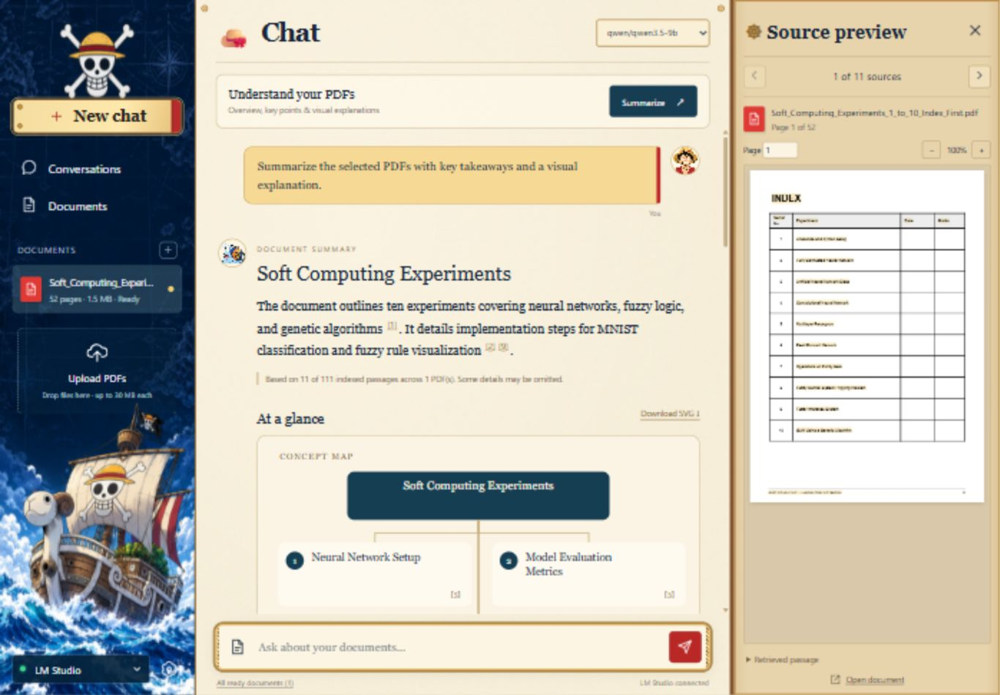
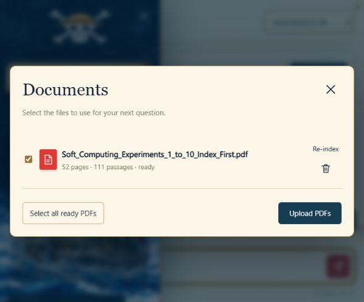
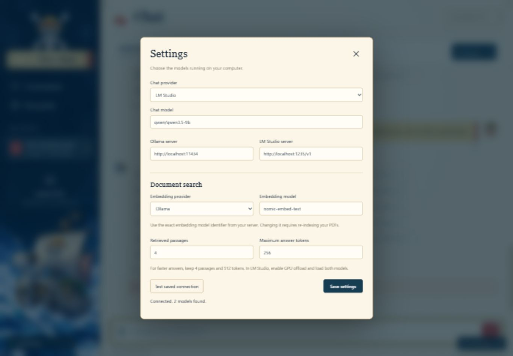
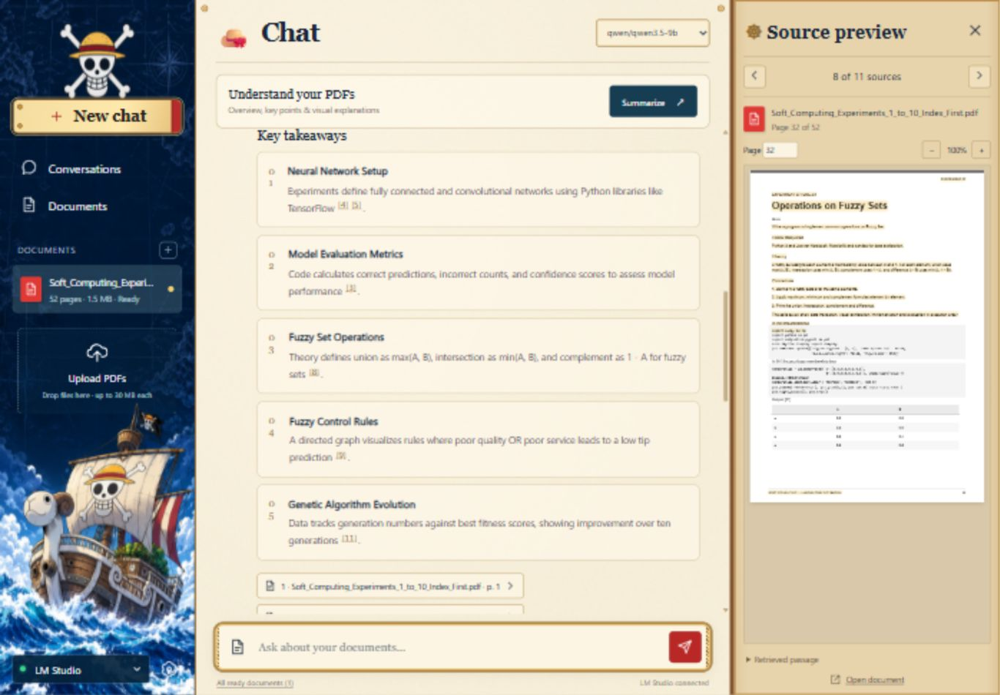
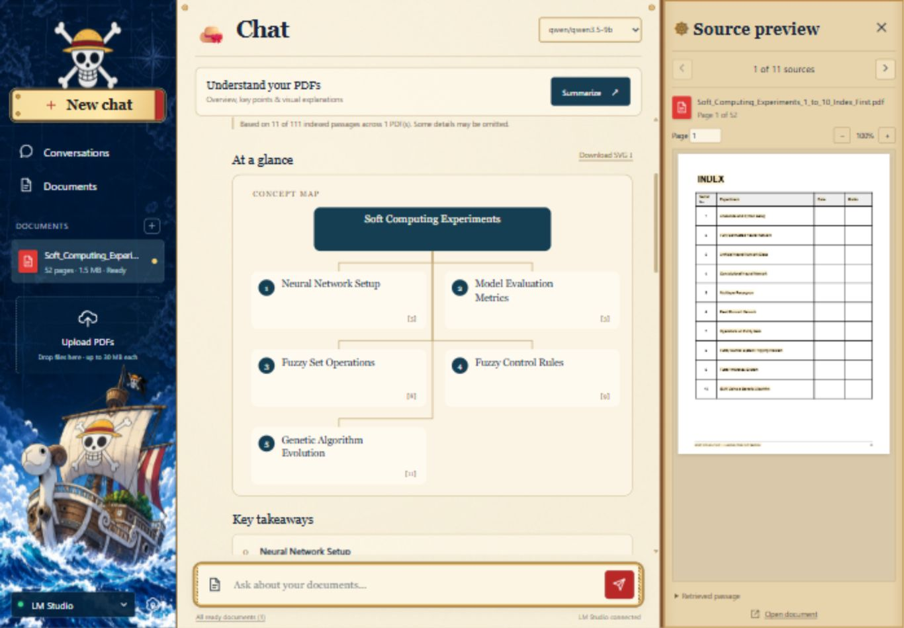
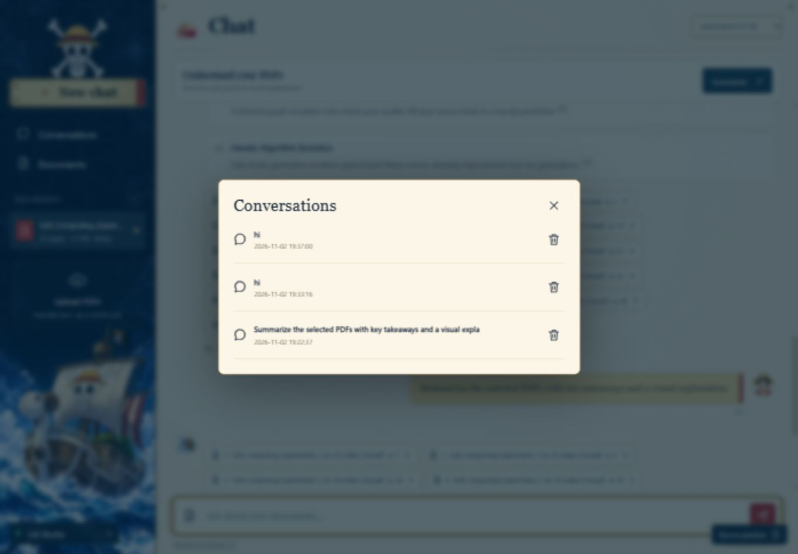

# PDF chat

A local PDF question-answering application with a One Piece inspired interface, streamed answers, saved conversations, selectable documents, and page references. Supports both Ollama and LM Studio, including separate providers for chat and embeddings. No cloud account or paid API key is required.



## Features

| Feature | What you can do |
| --- | --- |
| PDF uploads | Upload multiple text-based PDFs and keep them in a searchable document library. |
| Local model providers | Use Ollama or LM Studio, with independent chat and embedding models. |
| Connection check | Test the saved chat server and view its available model count. |
| Document questions | Ask questions about selected PDFs and read answers as they stream. |
| Visual summaries | Generate an overview, 2–5 cited takeaways, and a concept map or process diagram. |
| Visual downloads | Save the generated diagram as an SVG file. |
| Source verification | Open citations at the original PDF page, inspect passages, and adjust page and zoom. |
| Conversation history | Reopen saved chats and visual summaries, or start a new conversation. |
| Answer controls | Copy an answer or stop an answer while it is being generated. |
| Document management | Select files, retry indexing, or delete a document and its search index. |

[Start the app](#start-on-windows) · [Upload PDFs](#1-upload-and-select-pdfs) · [Check the model connection](#2-configure-models-and-check-the-connection) · [Create visual summaries](#4-create-a-summary-with-visuals) · [Troubleshooting](#troubleshooting)

## Technologies used

| Technology | Purpose |
| --- | --- |
| **Python** | Backend language. |
| **FastAPI + Uvicorn** | Local web server and API. |
| **HTML, CSS, JavaScript** | One Piece themed frontend and interactive controls. |
| **Ollama / LM Studio** | Run compatible AI models locally. |
| **Nomic Embed Text** | Converts document passages into vectors for semantic search. |
| **LangChain** | Document handling and splitting PDF text into smaller passages. |
| **ChromaDB** | Persistent vector storage and retrieval of relevant passages. |
| **PyPDF** | Extracts text from PDF pages. |
| **PDF.js** | Displays original PDF pages and source highlights. |
| **SQLite** | Saves settings, document metadata, conversations, and summaries. |
| **HTTPX** | Communicates with the local model servers and streams responses. |
| **Pydantic** | Validates settings, requests, and structured visual summaries. |
| **SVG** | Renders downloadable concept maps and process diagrams. |
| **Pytest** | Automated backend and provider integration tests. |

The application uses **Retrieval-Augmented Generation (RAG)** to answer questions using relevant passages from your PDFs. Choose a compatible local chat model in Settings. Cloud inference services and paid AI APIs are not required.

## Start on Windows

1. Install Python 3.13 (64-bit) with Python on PATH. Python 3.11–3.12 can also resolve compatible dependencies; this checkout was tested with Python 3.13.
2. Double-click **start.bat**, or run `powershell -ExecutionPolicy Bypass -File .\start.ps1` from this folder.
3. Open **http://127.0.0.1:8000**. The first launch installs dependencies; later launches use the existing environment.
4. Start a model server using either setup below. Open the gear icon in the app, enter the exact model identifiers, and save.
5. Upload a text-based PDF. Wait for its status to become **Ready**, then ask a question.

### Ollama

Install Ollama, keep it running, and download both a chat and an embedding model. For the tutorial's models:

```powershell
ollama pull mistral
ollama pull nomic-embed-text
```

In Settings choose **Ollama**, server `http://localhost:11434`, chat model `mistral`, embedding provider **Ollama**, and embedding model `nomic-embed-text`. Any other compatible local chat model can be selected instead.

### LM Studio

Download a GGUF chat model and a GGUF embedding model in LM Studio. Load them, enable GPU offload as appropriate, and start the server in its Developer tab. Choose **LM Studio**, server `http://localhost:1234/v1`, and copy the exact model identifiers from LM Studio into Settings. Set the embedding provider to **LM Studio** if both models are served there. Do not use a chat model as an embedding model.

Use the actual port shown by your LM Studio server. For example, the screenshots below use `http://localhost:1235/v1` for chat and Ollama's `nomic-embed-text` for embeddings. Mistral is optional; enter the exact identifier of your installed compatible chat model.

The provider dropdown changes the chat provider. The embedding provider stays independent so switching chat providers does not force you to rebuild embeddings. The chat model selector uses the server's model list; refresh the page after downloading new models. Settings also accepts manual model identifiers. Local server authentication is not currently supported; use the default unauthenticated loopback server.

## Using the app

### 1. Upload and select PDFs

1. Click **Upload PDFs** in the sidebar, the **+** beside Documents, or the attachment button beside the question box. You can also drop PDFs onto the sidebar upload area.
2. Choose one or more PDF files. Each file can be up to **30 MB**.
3. Wait until the file shows **Ready**. The app extracts text, creates embeddings, and stores its search index during this step.
4. Open **Documents** and tick the PDFs you want to use. **Select all ready PDFs** selects every indexed file.
5. Close the dialog to ask questions or create a summary. Try `examples/RAG Guide.pdf` for a small example.



Only selected ready documents are used. If a file needs attention, read its error in Documents and choose **Re-index** after fixing the cause. Scanned PDFs need OCR before upload, and password-protected files must be unlocked.

### 2. Configure models and check the connection

1. Start Ollama or enable LM Studio's local API server.
2. Click the **gear icon** in the sidebar to open Settings.
3. Choose the **Chat provider**, enter its local server URL, and enter the exact **Chat model** identifier.
4. Set the **Embedding provider** and **Embedding model**. These can use a different provider from chat. Keep both servers running when using this mixed setup.
5. Click **Save settings**. Reopen Settings and click **Test saved connection**.
6. Look for **Connected. N models found.** The status beside the question box also changes to **Ollama connected** or **LM Studio connected**.



**Test saved connection checks the saved chat server**, rather than unsaved form edits. It lists available models; it does not generate a test answer or verify the separate embedding server. Uploading and indexing a PDF verifies embeddings, and asking a question verifies chat generation.

Changing the chat provider or model does not require re-indexing. Changing the embedding provider, URL, or model requires **Re-index** for existing PDFs.

### 3. Ask questions and inspect sources

1. Select your PDFs in **Documents**.
2. Type a question, such as **“What are the main steps described in this document?”**
3. Press **Enter** or click the send button. Use **Shift+Enter** for a new line.
4. Read the streamed answer, then click a numbered citation or source chip to open **Source preview**.
5. Use the previous/next source controls, page number, and zoom buttons to inspect the original PDF. Expand **Retrieved passage** to read the exact excerpt, or choose **Open document** for the full PDF.



The **Copy** button copies an answer. While generation is running, the send button becomes **Stop**. Stopping saves any partial text as an interrupted response.

### 4. Create a summary with visuals

1. Select up to **8 ready PDFs** in Documents.
2. Click **Summarize** above the conversation.
3. Read the overview and key takeaways. The visual becomes a **concept map**, or a **step-by-step diagram** when the document describes an ordered process.
4. Check the coverage note: long documents use sampled passages, so the result is a quick overview and may omit details.
5. Click **Download SVG** to save the diagram. Citations in the takeaways open the supporting PDF pages.
6. Ask follow-up questions in the same conversation.



These are diagrams generated from the document's key points. The app does not generate illustrations, bar charts, or pie charts. See [Visual summaries](#visual-summaries) for the context and response limits.

### 5. Manage conversations and documents

Open **Conversations** to reopen a saved chat, including its visual summary and source references. **New chat** starts a fresh conversation while keeping the PDFs in your library. The trash button deletes the selected conversation.



In **Documents**, use checkboxes to change the active files, **Re-index** to retry extraction and embeddings, or the trash button to delete a PDF and its indexes. Deleting a PDF makes its old source links unavailable.

## Troubleshooting

| Problem | What to check |
| --- | --- |
| Model provider shows offline | Start the local server and check its exact URL and port in Settings. LM Studio's OpenAI-compatible URL must include `/v1`. Save before testing. |
| Connected, but no answer | Confirm the selected chat identifier is a chat model, rather than an embedding model. Check that it can load in the model server. |
| PDF indexing fails | Check the separate embedding server and exact embedding model identifier. Read the document error, then use Re-index. |
| Re-index needed | The saved embedding configuration changed. Re-index the PDFs with that configuration. |
| PDF has no readable text | Run OCR on the scanned PDF first, or upload a text-based copy. |
| Empty answer from a reasoning model | Try a higher answer-token limit or disable reasoning in the model server when supported, so the response budget is available for the answer. |
| Summary cannot be formatted | Retry Summarize or choose another compatible chat model. The model must return the structured summary format. |
| Answers are slow | Enable GPU offload, use a model that fits GPU memory, and allow the first model load to finish. Reduce retrieved passages or answer tokens for ordinary questions. |
| App does not open | Run start.bat from the project folder and keep its server window open. Visit http://127.0.0.1:8000/. |

## How it works

- **PyPDF** extracts text page by page.
- **LangChain** document objects and recursive splitter create 800-character passages with 80-character overlap.
- The selected local embedding server embeds passages in batches of 24.
- **ChromaDB** stores embeddings persistently, in a separate collection for each embedding configuration.
- For each question, up to 4 passages plus a short conversation history are sent to the selected local chat server.
- **FastAPI + HTTPX** stream the response to a buildless HTML/CSS/JavaScript frontend. SQLite stores conversations and document metadata.
- Source chips open the original PDF at its referenced page. Bundled **PDF.js** renders pages locally, with highlights over matching text runs and a collapsible retrieved-passage panel. Matching depends on how the PDF encodes its text; the passage panel remains available when a highlight cannot be placed.

## Response speed

Answers stream immediately after retrieval and model startup. Embeddings are generated once per document, query embeddings are cached, retrieval context is bounded, and Ollama models are kept warm for 30 minutes. The UI batches token rendering once per animation frame. Defaults are 4 retrieved passages and a 512-token answer cap.

With your RTX 4060 and 28 GB RAM, use a quantized model that fits GPU memory and enable GPU offload in LM Studio. Large context windows, reasoning models, cold model loads, and CPU fallback can increase latency. Actual tokens per second depend on the loaded model and GPU configuration; no fixed response time is promised.

## Data and controls

All app data is in `data/`: PDFs, SQLite history/settings, and the Chroma index. No CDN, external fonts, cloud inference, or automatic model downloads are used by the app. Initial dependency and model downloads need internet. Chroma telemetry is disabled. The web server and model URLs are restricted to the local machine by default.

- **Documents:** select which ready PDFs to query, retry indexing, or delete a PDF and its indexes.
- **Conversations:** reopen or delete saved conversations.
- **New chat:** starts a fresh conversation without deleting documents.
- **Stop:** cancels an in-progress answer. A partial answer is marked interrupted in saved history.
- Changing only the chat model requires no re-indexing. Changing embedding provider, URL, or model marks existing PDFs as needing re-indexing. Re-index each file in Documents.
- Maximum PDF upload: 30 MB. Scans need OCR first. Encrypted PDFs must be unlocked before upload.
- Ctrl+C in the server window stops the app. Keep the local model server running while using it.

## Development and verification

```powershell
.\.venv\Scripts\python.exe -m pytest -q
node --check static/app.js
node --check static/summary.js
```

Tests exercise real PDF extraction and Chroma retrieval with deterministic fake inference, plus both providers' HTTP streaming protocols. They do not download models. For a full hardware test, start your model server, choose its models, upload a real PDF, and ask a question with a known answer.

The themed illustration is a generated local asset in `static/assets/sidebar.png`. The project intentionally has no product name or branded marketing copy.

`requirements-lock.txt` records the versions verified on this machine; the launcher uses it for a fresh installation on Python 3.12 or newer. Python 3.11 uses `requirements.txt` to resolve compatible versions. PDF.js 6.5.438 and its required browser assets are vendored under `static/vendor/pdfjs`, including licenses, so previews need no CDN or npm installation.

An optional real-model test is available with `.\.venv\Scripts\python.exe scripts/live_check.py --model <installed-ollama-model>`. It adds `examples/RAG Guide.pdf` to the library, configures Ollama and Nomic embeddings, saves two example conversations, and records cold/warm timings in `data/live-check.json`. This changes the app's saved model settings, so run it only when you intend to use that setup.


## Visual summaries

Select ready PDFs in Documents and click **Summarize** above the conversation. The local chat model produces an overview, 2–5 cited takeaways, and a concept map or step-by-step diagram. Click citations to inspect the original PDF. Use **Download SVG** to save the diagram. Summaries are saved with conversations and support follow-up questions.

Summaries work with both Ollama and LM Studio. To keep the context small, each summary uses up to 12 indexed passages / 7,000 characters from up to 8 PDFs, distributed across the documents. A coverage note explicitly indicates sampled passages; this is a quick overview, not an exhaustive whole-document review. Summary generation uses a separate 1,200-token response budget. No chart values or numeric comparisons are manufactured.
